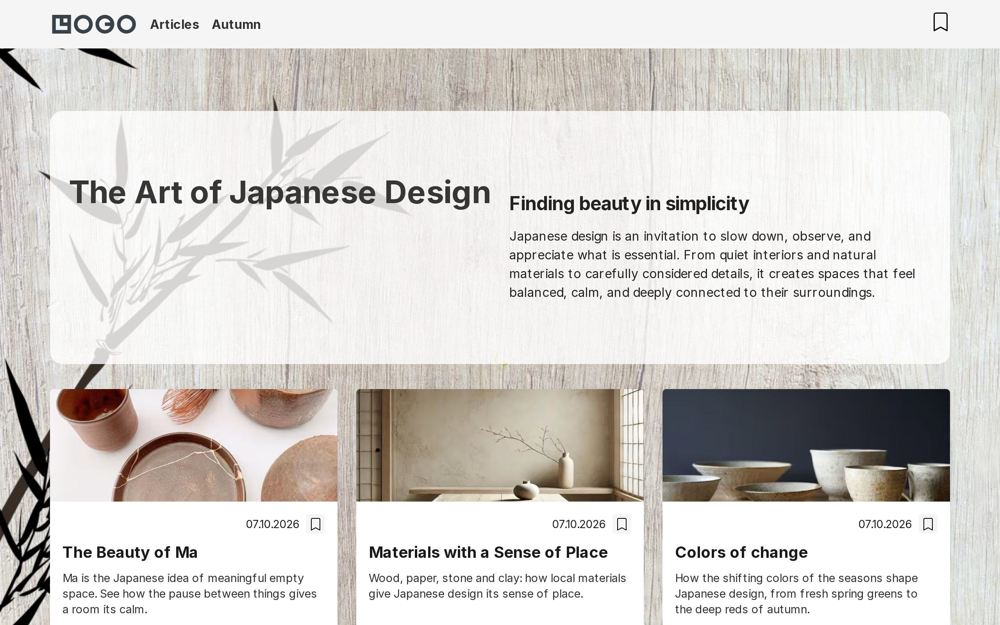
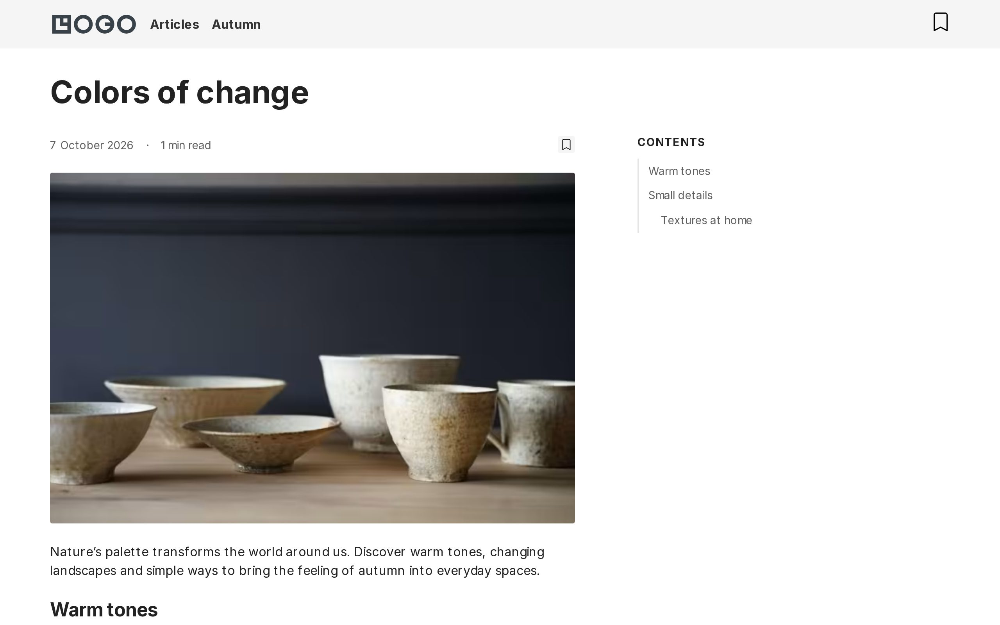
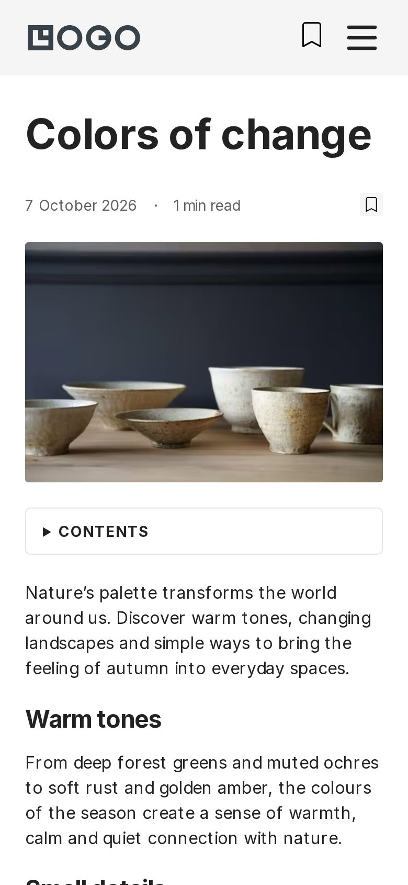

# Wudo Drupal starter

A Drupal 11 starter kit that turns into a working site with one command: a
fast, accessible and secure site with a component-based theme, ready for
editors on day one, and readable by search engines and AI assistants.

[](https://github.com/wunderio/wudo_starter/actions/workflows/ci.yml)




<p>
  
  
</p>

## Contents

- [Features](#features)
- [Setup](#setup)
  - [Quick start](#quick-start)
  - [Starting a new site](#starting-a-new-site)
  - [Installing without DDEV](#installing-without-ddev)
- [Using the site](#using-the-site)
  - [Roles](#roles)
  - [Content types](#content-types)
  - [Article pages](#article-pages)
  - [Banners](#banners)
  - ["Follow us" links](#follow-us-links)
  - [SEO, discovery and security](#seo-discovery-and-security)
- [Optional features](#optional-features)
  - [Adding a language](#adding-a-language)
  - [Adding projects](#adding-projects)
  - [Adding search](#adding-search)
  - [Adding AI tools](#adding-ai-tools)
  - [Adding cookie consent](#adding-cookie-consent)
- [Developing](#developing)
  - [Repository layout](#repository-layout)
  - [Configuration](#configuration)
  - [Content recipes](#content-recipes)
  - [Theme development](#theme-development)
  - [Component catalog](#component-catalog)
  - [Quality checks](#quality-checks)
- [Deploying](#deploying)
  - [Production](#production)
  - [Settings and secrets](#settings-and-secrets)

## Features

**Quick setup**
- One-command install from configuration kept in Git.
- Optional demo content: articles, a gallery and landing pages.
- New client sites from the starter, each with its own name, look and Git
  history.

[Read more →](#setup)

**Theme**
- Single Directory Components in atomic layers, with Twig, SCSS and JS side
  by side.
- A Storybook catalog generated from the components.
- Favorites saved in the browser, light and dark mode.
- Each site's colors, fonts and logo kept apart from the starter.

[Read more →](#theme-development)

**Content types**
- Landing pages built from paragraphs: hero, sections, cards, media, text,
  parallax layers and views.
- Articles with readable text, reading time and a table of contents.
- Galleries of images with a lightbox.
- Projects for a portfolio, with facts and filters (optional).

[Read more →](#content-types)

**For editors**
- A content editor role that runs the site without reaching site building.
- Banner blocks made from the media library.
- Optional AI help: alt text, page descriptions and a writing assistant.

[Read more →](#roles)

**SEO and AI discovery**
- Meta tags, Open Graph and canonical URLs.
- An XML sitemap and redirects for changed URLs.
- schema.org structured data (JSON-LD).
- A `robots.txt` that keeps AI training crawlers out, and an `llms.txt`.

[Read more →](#seo-discovery-and-security)

**Security and privacy**
- A strict Content Security Policy: scripts from the site itself only.
- HSTS and referrer policy headers.
- No credentials in Git; secrets come from the environment.
- An optional consent notice that blocks third parties until the visitor
  agrees.

[Read more →](#seo-discovery-and-security)

**Optional features**
- More languages.
- A project portfolio with filters.
- Site search with results while typing.
- AI tools for editors.
- Cookie consent, with Google Analytics if needed.

[Read more →](#optional-features)

**Quality**
- Drupal coding standards and static analysis.
- Unit tests and browser tests of every page.
- Accessibility checked against WCAG 2.2 AA.
- Lighthouse scores of 100 for accessibility, best practices and SEO.
- All of it in CI on every pull request, with an install from scratch.

[Read more →](#quality-checks)

**Deployment**
- Your own Ubuntu server: DDEV behind nginx with Let's Encrypt.
- Deploy, backup and restore built in.
- Automatic deploys from GitHub once CI passes.
- A copy of the live site for local development.

[Read more →](#deploying)

## Setup

### Quick start

Requires [DDEV](https://ddev.com). Everything else, including Composer and
Node.js, runs inside the containers.

```bash
git clone git@github.com:wunderio/wudo_starter.git && cd wudo_starter
ddev start
ddev site-install
```

`ddev site-install` installs the Composer and npm dependencies, builds the
theme, installs Drupal from the configuration in `config/sync/`, creates the
home page and the error pages, builds the XML sitemap and prints a one-time
login link. Add `--demo` to install the demo
content (articles, a gallery and landing pages) instead of the bare home page:

```bash
ddev site-install --demo
```

Running the command on an existing site reinstalls it; Drush asks before
dropping the database.

### Starting a new site

To build a site on the starter rather than work on the starter itself, run
this from the starter's directory:

```bash
ddev new-site acme --title="Acme Ltd" --mail=info@acme.example --demo
```

It creates `../acme` with the full Git history, names the DDEV project
`acme` so that it runs next to the starter and other sites, sets the site
name and e-mail address in `config/sync`, gives the site its own
`site/` directory in the theme for its look, and installs the site. Leave out
`--demo` and use `--install` for the bare home page, or neither to install
later. `--dir=` puts it somewhere else.

The new repository has no `origin`; the starter is kept as the remote
`starter`. The changes are left uncommitted:

```bash
cd ../acme
git commit -am "Start acme"
git remote add origin <repository> && git push -u origin HEAD
```

From then on the site lives on its own. To pick up a later improvement of the
starter, `git fetch starter` and `git cherry-pick` the commit, or
`git merge starter/main` for everything.

### Installing without DDEV

Create `web/sites/default/settings.local.php` with the database connection
(see `web/sites/example.settings.local.php`), set the `DRUPAL_HASH_SALT`
environment variable, then run from the project root:

```bash
composer install
(cd web/themes/custom/wudo && npm ci && npm run build)
vendor/bin/drush site:install --existing-config
vendor/bin/drush recipe ../recipes/error_pages
vendor/bin/drush recipe ../recipes/base_content
vendor/bin/drush xmlsitemap:rebuild
```

Use `../recipes/demo` in place of `../recipes/base_content` for the demo
content.

## Using the site

### Roles

- **Administrator** builds the site: content types, views, modules, settings.
- **Content editor** (`content_editor`) runs it day to day: creates, edits and
  deletes every content type, uploads media, manages tags, menu links, URL
  aliases, redirects and banners, and uses the rich text editor. It cannot
  reach people, modules, content types, views, appearance or site settings.

Give a client the content editor role. A browser test signs in as one, writes
an article and checks which admin pages open and which answer 403.

### Content types

| Type | For | Read more |
| --- | --- | --- |
| Landing page | Pages built from paragraphs: hero, section, layout, card, media, text, parallax layer and view (a list of content). The home page is one. | |
| Article | Writing: a main image and the body, with the date, reading time and a table of contents from its headings. | [Article pages](#article-pages) |
| Gallery | A set of images shown in a grid that opens in a lightbox. | |
| Project | A piece of work for a portfolio: facts, a description, a gallery, and a filtered list of all projects. Optional. | [Adding projects](#adding-projects) |

Every type has a description: the meta description in search results, and
the summary on the cards in lists.

### Article pages

- **Cards** in lists show the article's description, or the first lines of
  its body when it has none, in at most three lines.
- **Header**: the publication date, the reading time (at 200 words a minute)
  and a favorite button, above the main image.
- **Readable text**: about 75 characters a line.
- **Table of contents** from the H2 and H3 headings, once there are at least
  two. The headings get anchor ids, so a section can be linked to:
  `/article/…#warm-tones`.
- **Responsive**: the contents are in a sidebar on wide screens, marking the
  section being read, and a collapsible list above the article on small
  screens.
- **Sidebar**: the "Sidebar second" region. The contents appear on articles
  only; other blocks there follow their own visibility settings and come
  below the article on small screens. A page with nothing in the sidebar has
  one column.

### Banners

- **Banner** block type: an image from the media library and an optional
  link. The whole image is the link.
- **Ads**: a link to another site is marked `rel="sponsored"`, as search
  engines expect.
- **Size**: as wide as the sidebar; upload images 800 px wide for sharp
  screens.

**Configuration**: content editors make banners at Content → Blocks → Add
content block. An administrator places one in "Sidebar second" at Structure →
Block layout; "Content type: Article" under Visibility keeps it to articles.

### "Follow us" links

- **Footer block** listing the links of the "Social links" menu as icons;
  hidden while the menu is empty.
- **Icons from the address**: Facebook, Instagram, X, LinkedIn, YouTube,
  TikTok, Threads, Bluesky, Mastodon, WhatsApp, Telegram, Pinterest, GitHub,
  `mailto:` addresses and RSS feeds are recognised; anything else gets a
  globe.

**Configuration**: add the profiles at Structure → Menus → Social links
(`/admin/structure/menu/manage/social`); pasting
`https://www.instagram.com/yourname` is enough, and the link title is the
name read by screen readers. To recognise another network, put its icon in
the theme's `assets/icons` and its domain in `wudo_preprocess_menu__social()`
in `wudo.theme`.

### SEO, discovery and security

- `metatag` provides titles, descriptions, canonical URLs and Open Graph tags.
- `xmlsitemap` serves `/sitemap.xml` for all three content types; the error
  pages and the front page node are left out.
- `redirect` keeps old URLs working when aliases change.
- `schema_metatag` adds schema.org structured data (JSON-LD) that search
  engines and AI assistants read: the site and its publisher on the front
  page, a breadcrumb on every other page and the details of each article. The
  publisher's logo is the theme logo (`[site:logo-url]`), so each site's own
  `site/logo.svg` is used. Adjust at `/admin/config/search/metatag`.
- `robotstxt` serves `/robots.txt` from configuration instead of a file, with
  the address of the sitemap. Search and assistant crawlers that link back
  (OAI-SearchBot, ChatGPT-User, Claude-SearchBot, PerplexityBot and the like)
  may crawl the site; crawlers that only collect training data (GPTBot,
  ClaudeBot, Google-Extended, CCBot and others) are kept out. Edit the list at
  `/admin/config/search/robotstxt`.
- `llms_txt` serves `/llms.txt`, a Markdown summary of the site for AI
  assistants ([llmstxt.org](https://llmstxt.org)): the site name and slogan,
  the main menu and the sitemap. Edit it at `/admin/content/llms-txt`.
- `csp` enforces a Content Security Policy that allows scripts from the site
  itself only. Inline scripts and inline event handlers (`onclick="…"`) are
  blocked, so attach behavior from JavaScript files. Embeds are allowed from
  YouTube and Vimeo; add other sources at `/admin/config/system/csp`.
- `seckit` sends `Strict-Transport-Security` and `Referrer-Policy`.

## Optional features

Each of these is a recipe in `recipes/`, added with one command on a fresh or
a running site. The configuration is exported afterwards, so the feature is
part of the site from then on, including fresh installs: review and commit
`config/sync` (and `composer.json` and `composer.lock` when the command
downloads modules).

### Adding a language

The starter ships with one language, English. To make the site multilingual,
run one command with the code of the language to add:

```bash
ddev add-language lv
```

It can be run again for every further language. The command:

- installs Content Translation and Configuration Translation;
- adds the language and downloads its interface translations;
- makes content, media, taxonomy terms, menu links, blocks and paragraphs
  translatable;
- places the language switcher in the header;
- makes the front page and error page aliases work in every language;
- adds an XML sitemap per language (`/lv/sitemap.xml`);
- exports the configuration, so the language is part of every later install.
  Review and commit the changes in `config/sync`.

URLs get a language prefix (`/en/...`, `/lv/...`) and `/` redirects to the
default language. Content stays in English until it is translated: an
untranslated page is not listed in the other language and its alias only
works under `/en`.

Without DDEV, run the steps yourself:

```bash
drush pm:install content_translation config_translation
drush language:add lv
drush wudo:multilingual
drush xmlsitemap:rebuild
drush config:export
```

### Adding projects

A portfolio of projects is optional. Add it with one command, on a fresh or a
running site:

```bash
ddev add-projects           # or: ddev add-projects --demo, with four examples
```

It applies the `recipes/projects` recipe, which adds:

- the "Project" content type, with the alias `/projects/<title>`;
- the "Project categories" and "Project statuses" vocabularies; the statuses
  come with "Concept", "In progress" and "Completed";
- the `/projects` list with a "Projects" link in the main menu, sorted by
  year and filtered by category and status;
- projects in the XML sitemap, and translatable projects on a multilingual
  site.

The configuration is exported afterwards, so projects are part of the site
from then on, including fresh installs.

#### Fields or vocabularies

The rule the content type follows, and the one to keep when adapting it:

- a value that **repeats across projects and that visitors pick from** is a
  vocabulary: category, status. Add one for anything else to filter by, e.g.
  services, city or material;
- a value that **belongs to one project** is a field: location, area, year,
  client. Numbers are number fields, so that the list can be sorted by them.

| Field | Type | Notes |
| --- | --- | --- |
| Description | text | card text and meta description |
| Main image | media | card and top of the page |
| Category | "Project categories" terms | several allowed, filter |
| Status | "Project statuses" term | filter |
| Location | text | address or place |
| Area | whole number | the suffix "m²" is a field setting |
| Year, End year | whole numbers | shown as "2025–2026", list sorted by year |
| Client | text | |
| Body | formatted text | |
| Gallery | media | lightbox |

#### Adapting it

Everything is done in the UI, without touching templates:

- rename, remove or add fields at Structure → Content types → Project. On the
  project page, every field enabled in "Manage display" becomes a row of the
  facts list, labelled with the name of the field, in the order set there.
  Only the main image, body and gallery have a fixed place;
- to filter by a new vocabulary, add a term reference field and expose it as a
  filter in the "Projects" view;
- filters of every view are shown by the `wudo:filter-bar` component: in the
  page on wide screens, in a drawer on narrow ones, with results updated in
  place. See `components/03-organisms/filter/README.md` in the theme;
- the page title block is shown on listed paths only; keep `/projects` and
  `/projects/*` on that list when changing the aliases.

### Adding search

Search is optional, like projects:

```bash
ddev add-search
```

It adds a search button next to the favorites in the header. The button
opens a drawer with a search field; the first results appear while typing,
with the matches marked, and a link leads to all of them on `/search`.
Without JavaScript the button is a link to `/search`, which has its own
form.

- Every published page of every content type is searched, in the language
  the visitor is reading. A content type added later is included on its own.
- What is searched is the page as a visitor sees its fields
  (`node--search-index.html.twig`), so text in paragraphs is found too. The
  error pages are left out.
- New and changed pages are searchable as soon as they are saved.
- Results come from `/api/search?q=…` as JSON: `total`, `items` (`title`,
  `url`, `type`, `excerpt`) and the `url` of the search page.

It is built on the Search API module with its database backend: no extra
service, and nothing to set up on the server. Searches match parts of words
("mat" finds "materials"), but not misspellings or other forms of a word.
For that, the "Database" server at `/admin/config/search/search-api` can be
replaced with Solr or Elasticsearch; the button, the drawer, the endpoint and
the page stay as they are, because they only know the index.

After restoring a backup the index comes with the database. Should it ever be
out of step: `ddev drush search-api:rebuild-tracker && ddev drush search-api:index`.

### Adding AI tools

AI helpers for editors are optional too. Visitors see nothing of them.

```bash
ddev add-ai
echo 'AI_API_KEY=sk-ant-...' >> .ddev/.env
ddev restart
```

The answers come from Anthropic Claude (`claude-sonnet-5-5`); create a key at
[console.anthropic.com](https://console.anthropic.com/settings/keys). On a
production server the key goes into the server's `.ddev/.env` as well
(`deploy/env.example`). The key is read from the environment by the Key
module and is never stored in the database or in `config/sync`.

- **Alt text.** Next to the alternative text of an uploaded image there is a
  "Generate" button. The text is written in the language of the page, and
  the editor checks it before saving. Images that are already on the site
  get theirs at `/admin/config/media/ai_image_bulk_alt_text`.
- **Description.** The description of a page (its meta description in
  search results) gets a "Generate" button that writes one from the body
  text: 120–155 characters, in the language of the text. It is added to every
  content type with a body (articles, galleries, and projects when they are
  installed first); run `ddev add-ai` again after adding projects later.
- **Text editor.** The "AI Assistant" button at the end of the toolbar
  completes, rewrites the selected text by an instruction, fixes spelling,
  summarizes or translates. The result is shown first; the editor
  inserts it or not.

Content editors may use all three. The model and the prompts can be changed
at `/admin/config/ai`. Without a key the site works as before; the buttons
report an error and the reason is logged ("Could not load the Anthropic API
key").

What editors send to the AI goes to Anthropic. A site with personal data in
its content needs a data processing agreement with Anthropic first.

### Adding cookie consent

A consent notice is optional; a site that sets no cookies beyond its own and
embeds nothing does not need one. Add it with one command:

```bash
ddev add-consent                 # consent notice, YouTube and Vimeo placeholders
ddev add-consent G-XXXXXXXXXX    # the same, plus Google Analytics 4
```

It downloads [Klaro!](https://www.drupal.org/project/klaro) (and
[Google Tag](https://www.drupal.org/project/google_tag) when a measurement ID
is given), applies `recipes/consent` or `recipes/consent_ga4`, and exports the
configuration. Commit `composer.json`, `composer.lock` and `config/sync`
afterwards.

What visitors get:

- a notice with equally prominent "Accept" and "Decline" buttons, and
  "Customize" to choose per service;
- a "Cookie settings" link in the footer menu to change the choice later;
- embedded YouTube and Vimeo videos replaced by a placeholder that loads the
  video on request.

Nothing is merely hidden: until the visitor agrees, the Google Analytics
script is in the page as inert `text/plain` and the browser neither runs it
nor contacts Google, and a video `iframe` has no `src`. The browser tests
check exactly that: no request to Google before consent or after declining,
requests after accepting, none again after withdrawing.

Things to do on a real site:

- set the privacy policy page at Configuration → Klaro! → Texts
  (`/admin/config/user-interface/klaro/texts`); it points to the front page
  until then;
- add other third parties as services at Configuration → Klaro!
  (`/admin/config/user-interface/klaro`), and allow their domains in the
  Content Security Policy. The recipe allows only what Google Analytics
  needs;
- services whose settings contain JavaScript code (Google's "consent mode"
  services, for example) do not run: the Content Security Policy does not
  allow evaluating strings as code. Blocking a script until consent, as done
  here, does not need any.

## Developing

### Repository layout

- `web/` is the Drupal document root.
- `web/themes/custom/wudo/` contains the custom theme and its component source.
- `web/modules/custom/wudo_theme_extension/` contains custom Drupal behavior and API endpoints.
- `recipes/` contains the content recipes and the optional features.
- `config/sync/` contains exported Drupal configuration tracked in Git.
- `tests/e2e/` contains the Playwright browser tests.
- `deploy/` and `docs/` hold the production setup and its documentation.
- `vendor/` and frontend dependencies are generated locally and are not committed.

Contributed extensions are managed by Composer. Custom extensions and recipes
are committed directly in this repository.

### Configuration

`config/sync/` is the single source of truth for site configuration, and the
site is installed from it. Export after making intentional changes and import
when deploying:

```bash
ddev drush config:export
ddev drush config:import
```

### Content recipes

- `recipes/error_pages` holds the "Page not found" and "Access denied" pages
  and is always applied.
- `recipes/base_content` holds the home page. The front page setting points to
  its `/home` alias.
- `recipes/demo` holds the demo content, including its own `/home` page.

Apply only one of the last two to a site. To update a recipe from a running site,
export the entities with their dependencies:

```bash
ddev drush content:export node --with-dependencies --dir=../recipes/demo/content
ddev drush content:export menu_link_content --dir=../recipes/demo/content
```

The `wudo_theme_extension` module makes paragraphs and hand-set URL aliases
part of the export; paragraphs are written inline in the entity that owns them.

### Theme development

npm runs inside the web container: use `ddev npm …` or `ddev exec`. Run these
commands from `web/themes/custom/wudo`:

```bash
npm run dev
npm run dev:sdc
```

Build production assets with `npm run build`. `node_modules/`, `dist/` and the
`.css` files compiled next to each component's `.scss` are ignored by Git and
recreated by the build, so run it after changing any `.scss` file.

#### The site's own look

What makes a site look different from the starter lives in
`web/themes/custom/wudo/site/`: `_tokens.scss` for colors, fonts and sizes,
`site.scss` for everything else, and `logo.svg`. It is built into
`dist/site.css`, which is loaded after all other styles. Sizes of the layout
are tokens too, for example the article sidebar's width, `--sidebar-width`
(25rem, which fits the common 300 px ad sizes).

The starter does not track that directory; the build creates it from
`site.example/` when it is missing. `ddev new-site` adds it to the new site's
repository, so the site's styling is versioned there and can never conflict
with a later version of the starter. See the `README.md` in it.

#### Twig template suggestions

Enable Drupal's local theme development mode to show Twig template filenames
and suggestions as HTML comments in the page source:

```bash
ddev drush theme:dev on
ddev drush cr
```

Open the page source in the browser and look for comments such as
`THEME DEBUG` and `THEME HOOK SUGGESTIONS`. Disable it before production:

```bash
ddev drush theme:dev off
ddev drush cr
```

### Component catalog

```bash
ddev storybook
```

builds a Storybook catalog of the theme's Single Directory Components and
prints its address. Every page is generated from the component's
`*.component.yml` and rendered with its own Twig template, CSS and JS, so a
new component shows up without writing a story. See
`web/themes/custom/wudo/docs/storybook.md`.

### Quality checks

The same checks run in GitHub Actions (`.github/workflows/ci.yml`) on every
pull request, together with a full `ddev site-install --demo` from scratch.

```bash
ddev exec vendor/bin/phpcs      # Drupal coding standards
ddev exec vendor/bin/phpstan    # static analysis
ddev exec vendor/bin/phpunit    # tests, on a throwaway SQLite database
ddev npm run lint:css           # run in web/themes/custom/wudo
ddev e2e                        # browser tests against the installed site
```

`ddev e2e` runs the Playwright tests in `tests/e2e` inside the web container;
the first run downloads Chromium. They cover every page in the XML sitemap:

- smoke checks: status codes, one `h1`, no JavaScript or CSP errors, social
  links;
- interactions: favorites drawer, favorites via `/api/favorites`, mobile menu,
  project filters (in place, by address and without JavaScript) when projects
  are installed;
- consent: nothing is loaded from Google before consent, when consent is
  installed;
- search: results in the drawer while typing, the search page, and both
  without JavaScript, when search is installed;
- article page: date, reading time, line length, the table of contents in
  the sidebar and on small screens, and a banner beside or below the
  article;
- content editor: can write an article, cannot reach site building pages;
- AI tools: the assistant in the text editor, the description and the alt
  text buttons, when AI is installed (no requests to the AI provider are
  made);
- discovery: `robots.txt`, `llms.txt` and the structured data of the front
  page and an article;
- accessibility: axe-core, WCAG 2.2 AA, on desktop and mobile viewports;
- Lighthouse: accessibility, best practices and SEO must score 100.

Arguments are passed to Playwright, e.g. `ddev e2e a11y --project=desktop`.
The HTML report, with Lighthouse reports attached, is written to
`tests/e2e/playwright-report`. Tests that need articles are skipped unless
the site was installed with `--demo`.

`vendor/bin/phpcbf` and `npm run lint:css -- --fix` fix most style issues
automatically.

## Deploying

### Production

`docs/production.md` describes running the site on your own Ubuntu server:
DDEV behind the host's nginx with Let's Encrypt, production settings, mail
through SMTP, cron, and moving the site to another server. The files it uses
are in `deploy/`. Three commands do the routine work:

```bash
ddev deploy                          # update the running site to the latest code
ddev backup                          # database and uploaded files
ddev restore backups/<timestamp>     # put a backup back
```

With `.github/workflows/deploy.yml` set up, a push to `main` that passes CI is
deployed without logging in to the server; see "Deploying from GitHub" there.

`docs/local-development.md` describes the other direction: getting a copy of
the live site onto your machine and sending code and configuration back.

### Settings and secrets

`web/sites/default/settings.php` is tracked in Git and contains no credentials.
Database connections, API keys and other environment-specific values belong in
`settings.local.php`, which is ignored, or in environment variables. Never
commit credentials or production secrets.

The DDEV-generated `settings.ddev.php` is local-only. Its permissive
`trusted_host_patterns` setting is suitable for local development only; set
explicit host patterns before deploying to a shared or production environment.
